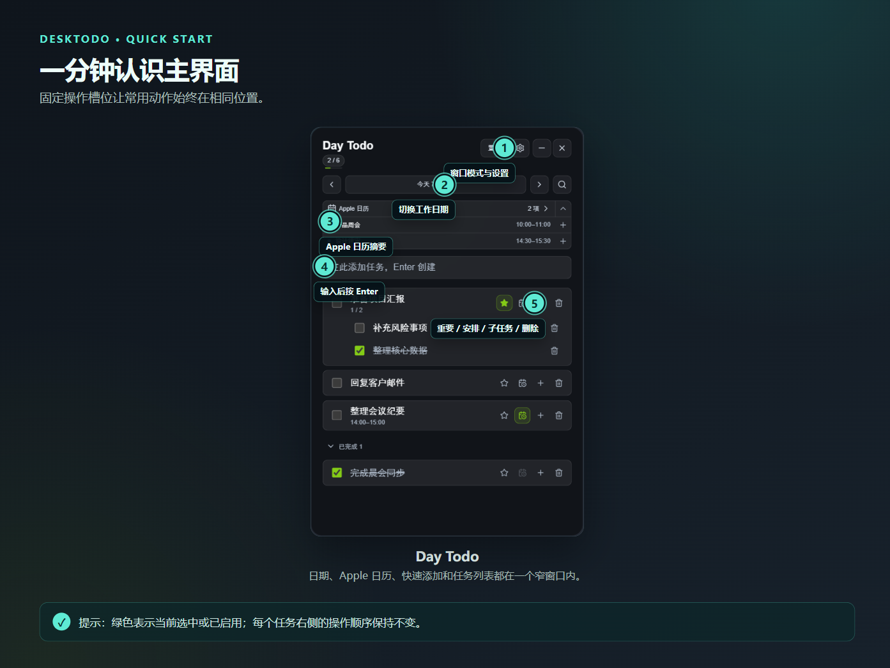
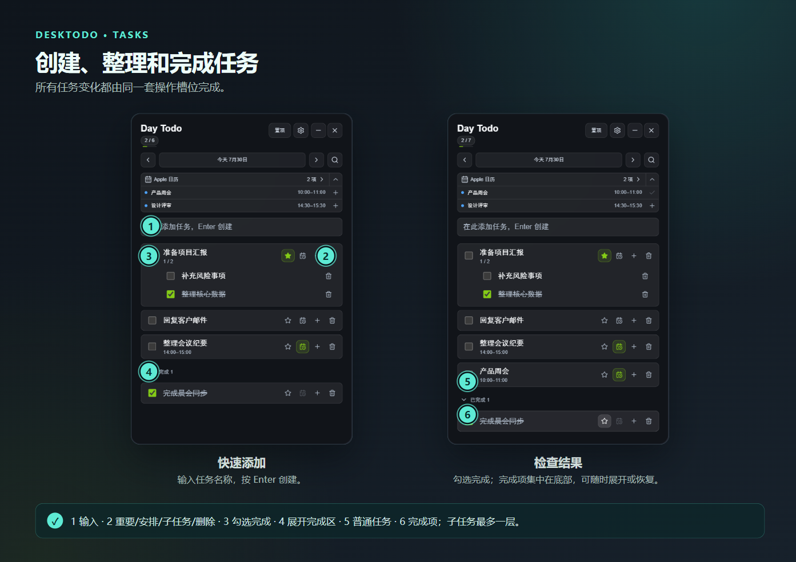
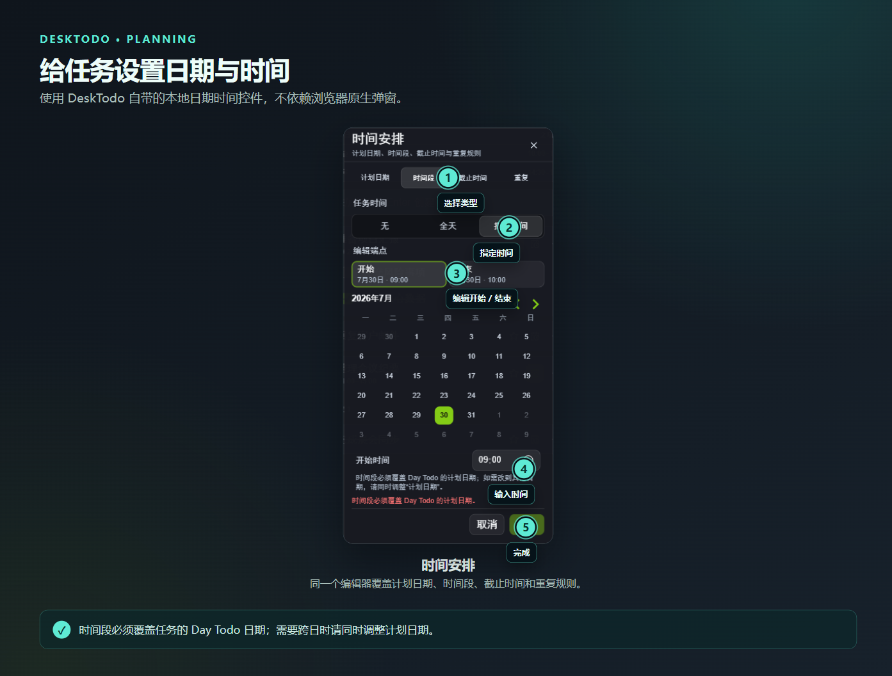
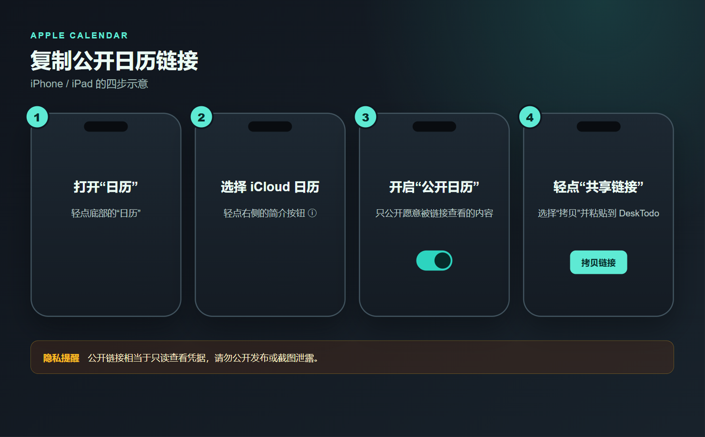
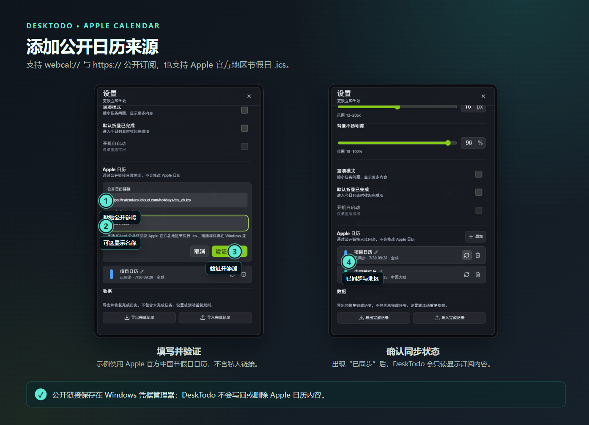
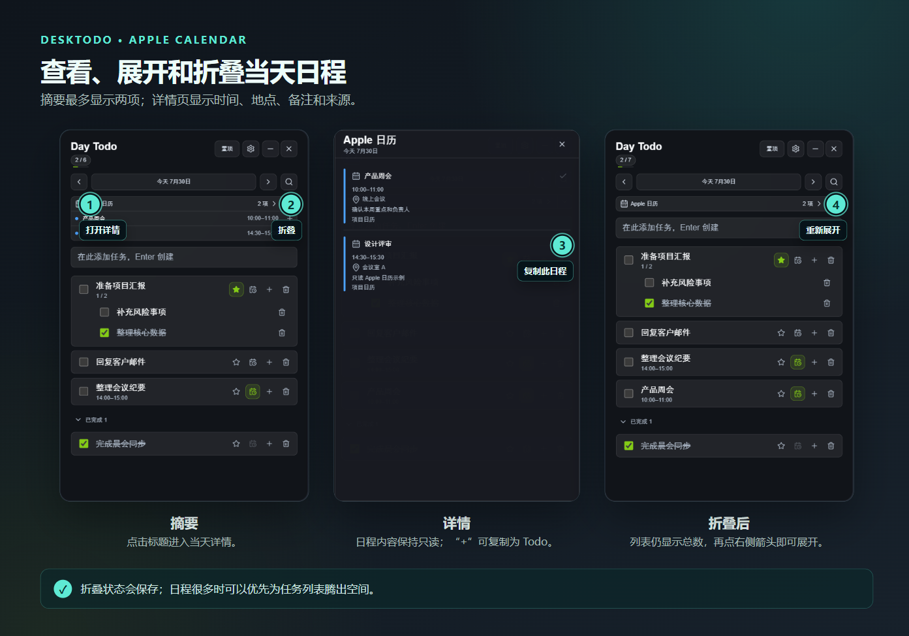
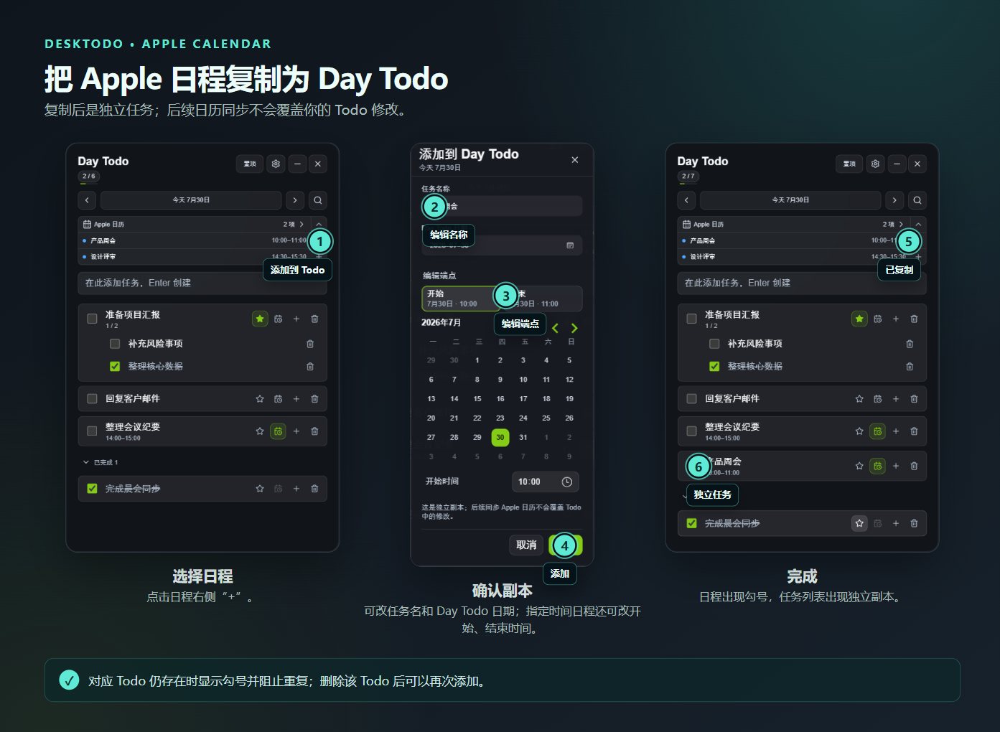
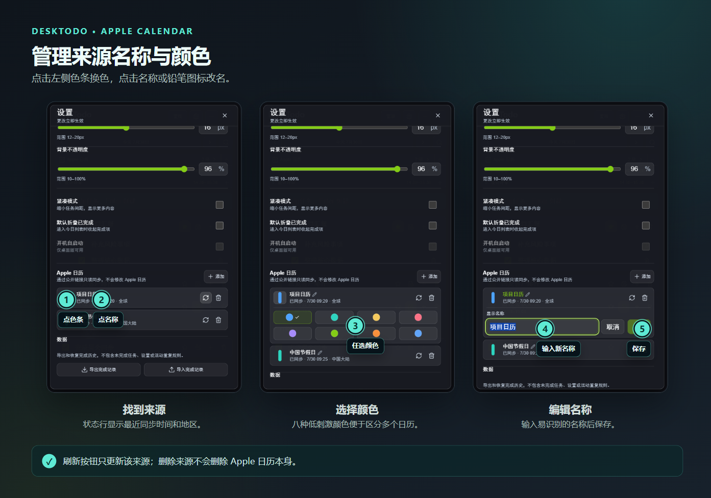
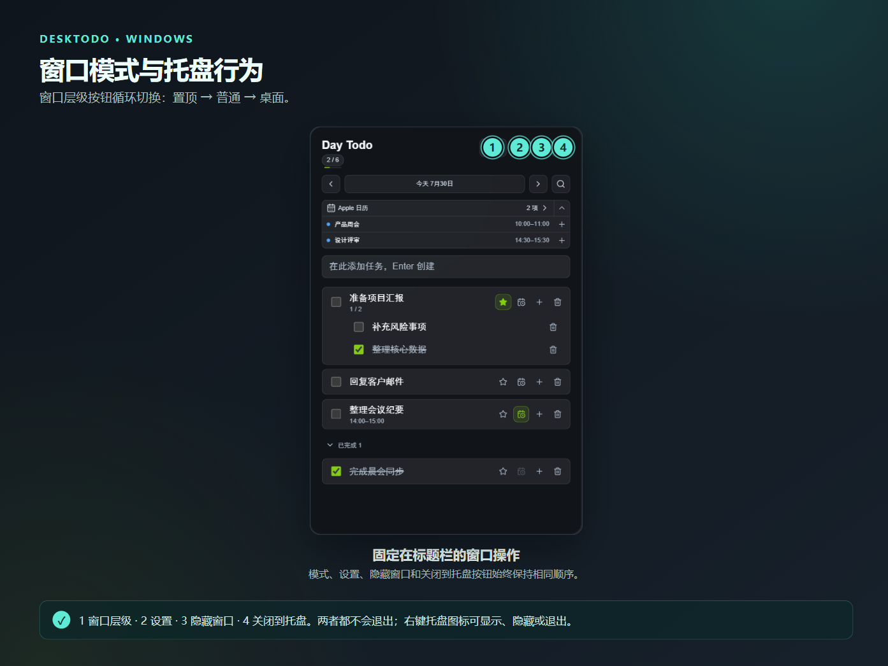

<p align="right">
  <a href="./user-guide.md">简体中文</a> · <strong>English</strong>
</p>

# DeskTodo Illustrated User Guide

Applies to DeskTodo v0.6.0. DeskTodo is a Windows-first, local-first Todo widget. Tasks, settings, and bounded calendar snapshots stay on the current PC; no account is required.

> [!NOTE]
> The current application UI is in Simplified Chinese. This guide repeats the exact Chinese labels you will see in the app.

> [!IMPORTANT]
> Apple Calendar support is a **one-way, read-only subscription to a public link**. DeskTodo never modifies Apple Calendar. Treat the public URL as a viewing credential and never post it in a public issue, chat, or screenshot.

## Contents

- [Quick tour](#quick-tour)
- [Create and manage tasks](#create-and-manage-tasks)
- [Plan dates, time blocks, deadlines, and recurrence](#plan-dates-time-blocks-deadlines-and-recurrence)
- [Add an Apple Calendar](#add-an-apple-calendar)
- [View and collapse Apple Calendar](#view-and-collapse-apple-calendar)
- [Copy an Apple event into Day Todo](#copy-an-apple-event-into-day-todo)
- [Manage calendar names and colors](#manage-calendar-names-and-colors)
- [Window modes and system tray](#window-modes-and-system-tray)
- [Data, privacy, and backup](#data-privacy-and-backup)
- [Keyboard shortcuts](#keyboard-shortcuts)
- [Troubleshooting](#troubleshooting)

## Quick tour



1. The title bar contains window layer, settings, hide-window, and close-to-tray controls.
2. The date row navigates Today, history, and future planning dates.
3. The Apple Calendar summary shows up to two events for the selected date.
4. Type in Quick Add and press `Enter`.
5. A parent task keeps Important, Time Arrangement, Add Subtask, and Delete in fixed slots.

## Create and manage tasks



1. Type a title in `在此添加任务` and press `Enter`.
2. Double-click a task title to edit it. Press `Enter` to save or `Esc` to cancel.
3. Use the checkbox to complete or reopen a task. Completed work is grouped under `已完成`.
4. Use `+` to add a subtask. DeskTodo supports one subtask level; children inherit the parent planning date.
5. Press and hold a task row, then drag to reorder. Important tasks are derived to the top without rewriting the regular stored order.

Use the star for Important, the magnifier or `Ctrl+F` for local search, and the trash button to delete. A deletion can be undone for eight seconds; `Ctrl+Z` also works when focus is outside an editor.

## Plan dates, time blocks, deadlines, and recurrence

Click the calendar/clock button on a parent task to open `时间安排` (Time Arrangement).



- `计划日期` — the Day Todo date on which the task appears.
- `时间段` — None, All Day, or a start/end time block.
- `截止时间` — a calm countdown or an explicit local deadline label; the final 30 minutes can show seconds.
- `重复` — Daily, Workdays, or selected weekdays. A series keeps at most one unfinished occurrence.

Planning date, time block, and deadline are separate fields. A cross-day time block must cover the Day Todo date; adjust the planning date when moving the task to another day.

## Add an Apple Calendar

### Step 1: copy a public calendar link

On iPhone or iPad:

1. Open Calendar.
2. Tap **Calendars** at the bottom, then tap the Info button `ⓘ` beside the target **iCloud calendar**.
3. Turn on **Public Calendar**.
4. Tap **Share Link**, then copy the URL.



Apple’s official instructions:

- [Share iCloud calendars on iPhone](https://support.apple.com/guide/iphone/iph7613c4fb/ios)
- [Share a calendar on iCloud.com](https://support.apple.com/guide/icloud/mm6b1a9479/icloud)

A public-calendar subscription URL commonly resembles:

```text
webcal://p123-caldav.icloud.com/published/2/••••••••
```

DeskTodo accepts Apple public-calendar links from mainland China and other regions. It safely maps `webcal://` to HTTPS. Official regional holiday feeds are also supported, for example:

```text
https://calendars.icloud.com/holidays/cn_zh.ics
```

Anyone who obtains a public URL may be able to read that calendar. Publish only a calendar suitable for link-based viewing, and never commit or log the URL.

### Step 2: validate and add it in DeskTodo

1. Click the gear and scroll to `Apple 日历`.
2. Click `添加` (Add).
3. Paste the URL. `显示名称（可选）` is optional.
4. Click `验证并添加` (Validate and Add).
5. Confirm the source shows `已同步` (Synced) and a recent time.



Up to eight sources are supported. DeskTodo accepts only allowlisted Apple public-subscription hosts and official holiday paths. Other domains, unsafe schemes, user information, query strings, or fragments are rejected.

Refresh runs after startup, about every five minutes, and after focus returns when the cache is stale. Temporary failures keep the last successful snapshot instead of replacing it with empty data.

## View and collapse Apple Calendar



1. The main summary shows at most two events.
2. Click `Apple 日历` to open the complete day view with time, location, notes, and source.
3. Click the up arrow to collapse the summary and free space for tasks.
4. The event count remains visible; click the down arrow to expand again.

The collapsed state is saved. All-day, cross-day, time-zone, and recurrence rules are parsed locally. Excluded dates and cancelled instances are omitted; moved instances appear at their updated time.

## Copy an Apple event into Day Todo

Apple Calendar remains read-only. To track an event as work:



1. Click `+` beside an event in the summary or full day view. Only today’s and future events can be copied; the control is disabled for past events.
2. Edit the task title if needed.
3. The Day Todo date cannot be earlier than today and must fall within the event’s date range. For an all-day event, check only the start and end dates; for a timed event, you can also edit the start and end times.
4. Click `添加`.
5. The event receives a checkmark, and an independent parent task appears in the task list.

The result is an **independent Todo**. Later calendar refreshes never overwrite it, and Todo edits never write back to Apple. While that Todo still exists, the event shows a checkmark and cannot be copied again; deleting the Todo allows it to be added again.

If the original event is deleted in Apple Calendar, it disappears from the read-only subscription view after the next successful refresh. Any independent Todo already copied from it remains.

## Manage calendar names and colors

Open `设置 → Apple 日历`.



- Click the color strip to choose one of eight subdued source colors.
- Click the source name or pencil icon to rename it.
- The refresh button updates that source only.
- The trash button removes DeskTodo’s local subscription and credential; it **does not delete the Apple calendar**.

## Window modes and system tray



The window-layer button cycles:

- `置顶` (Top) — above normal windows.
- `普通` (Normal) — normal window layer.
- `桌面` (Desktop) — best-effort below normal windows as a desktop sticker. This relies on the Windows compositor and is not embedded into the shell desktop.

The `—` button hides the window. The `×` button closes DeskTodo to the system tray. Neither action quits the app. Left-click the tray icon to restore the window; right-click for Show, Hide, or Quit.

If Desktop mode makes the widget hard to find, choose Show from the tray or launch DeskTodo again. It will recover into an operable Normal mode.

## Data, privacy, and backup

Todo data, settings, recurrence series, and the saved window-layer preference:

```text
%APPDATA%\com.desktodo.desktop\desktodo-state.json
```

Apple source metadata and the last successful bounded snapshot:

```text
%APPDATA%\com.desktodo.desktop\desktodo-calendar-state.json
```

The full public-calendar URL is stored in **Windows Credential Manager**, not in either JSON file, logs, or source code. DeskTodo has no accounts, analytics, telemetry, or Todo cloud sync.

Before an install or upgrade, quit DeskTodo and run:

```powershell
$backup = Join-Path $env:USERPROFILE "Desktop\DeskTodo-backup"
New-Item -ItemType Directory -Path $backup -Force
Copy-Item "$env:APPDATA\com.desktodo.desktop\desktodo-state.json" $backup -ErrorAction SilentlyContinue
Copy-Item "$env:APPDATA\com.desktodo.desktop\desktodo-calendar-state.json" $backup -ErrorAction SilentlyContinue
```

An in-place upgrade normally preserves data while the identifier remains `com.desktodo.desktop` and the Store filenames remain unchanged. Public-link credentials are not part of this file backup. When restoring only these two JSON files on another PC, remove the unavailable sources first, then add their public links again.

## Keyboard shortcuts

| Shortcut | Action |
| --- | --- |
| `Ctrl+N` | Focus Quick Add when no editor or calendar dialog is active |
| `Ctrl+F` | Open local task search |
| `Ctrl+Z` | Restore a pending deletion |
| `Enter` | Create a task or submit a title edit |
| `Esc` | Cancel a title edit or close the top dialog |

## Troubleshooting

### A public link cannot be added

Check that:

1. **Public Calendar** is enabled; a private invitation link is not sufficient.
2. The URL is an Apple `webcal://` or `https://` public subscription with no manually added query or fragment.
3. The PC can reach the corresponding Apple domain.
4. DeskTodo is v0.6.0 or newer.
5. An official holiday URL is copied in full and ends in `.ics`.

### The source is added but a day is empty

- Refresh the source and check whether it still says `已同步`.
- Navigate to a date that actually contains an event. DeskTodo uses Windows-local date semantics together with the event time zone.
- The calendar may simply have no event on that date. The summary shows two; click the title for the full list.
- A temporary error preserves the last successful snapshot and never deletes Todo data.

### Why can’t DeskTodo delete an Apple event?

This is a deliberate safety boundary. DeskTodo has no Apple write credential. Modify the original event in Apple Calendar, or copy it into an independent Day Todo for task tracking.

### Where did the app go after I clicked `×`?

It is in the system tray. Left-click the tray icon to restore it; right-click for Show, Hide, or Quit.

### How can I report a bug without leaking data?

Include the error text, DeskTodo version, and a cropped screenshot, but redact task titles, event contents, and public URLs. Never upload a real Store file, credential, or full calendar link.

---

[Back to README](../README.en.md) · [Download the latest release](https://github.com/star0628/DeskTodo/releases/latest)
